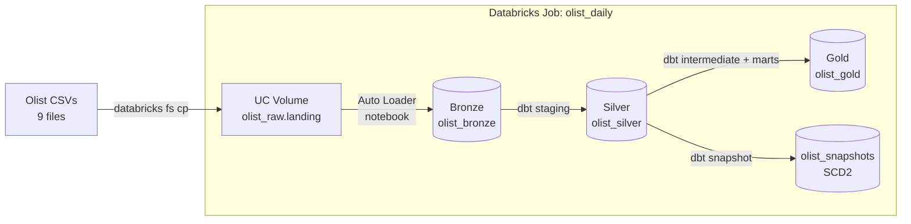

# Olist Lakehouse — dbt + Databricks

An end-to-end analytics lakehouse on **Databricks** and **dbt Core**, built on ~100k real orders from [Olist](https://www.kaggle.com/datasets/olistbr/brazilian-ecommerce), a Brazilian e-commerce marketplace (2016–2018).

Raw CSVs are ingested with **Auto Loader** into Delta tables, cleaned and modelled with **dbt** into a tested **star schema**, run in production by a **Databricks Job**, and protected by **CI on every pull request**.

---

## Architecture



| Layer | Schema | Built by | Contents |
| --- | --- | --- | --- |
| Landing | `olist_raw` (volume) | Databricks CLI | Raw CSV files, one folder per table |
| Bronze | `olist_bronze` | Auto Loader (PySpark) | Exact raw copy as Delta tables + `_ingested_at`, `_source_file` |
| Silver | `olist_silver` | dbt (views) | 9 staging models: typed, renamed, deduplicated |
| Gold | `olist_gold` | dbt (tables) | Star schema: 2 facts, 5 dimensions |
| Snapshots | `olist_snapshots` | dbt snapshot | SCD Type 2 history of products |

## Tech stack

Databricks Free Edition (serverless, Unity Catalog, Delta Lake, Auto Loader, Jobs) · dbt Core 1.12 + `dbt-databricks` · `dbt_utils`, `dbt_expectations` · Python 3.12 + uv · GitHub Actions

## Data model (gold)

| Table | Grain | Purpose |
| --- | --- | --- |
| `fct_orders` | one order | Amounts, payment split, review score, delivery days, `is_late` |
| `fct_order_items` | one item sold | Price, freight, product, seller (**incremental**, merge) |
| `dim_customers` | one real customer (`customer_unique_id`) | Latest location, first order, total orders |
| `dim_products` | one product | English category name |
| `dim_sellers` | one seller | Location |
| `dim_geography` | one zip prefix | Average lat/lng, city, state |
| `dim_date` | one day | Year, month, weekday, weekend flag |

## Quality and production features

| Feature | Where | What it guarantees |
| --- | --- | --- |
| **52 data tests** | `_olist__sources.yml`, `_olist__models.yml`, `_marts__models.yml` | Unique/not-null keys, fact → dimension relationships, accepted values, value ranges |
| **Unit test** | `_marts__unit_tests.yml` | The `is_late` business rule is correct for late, on-time and undelivered orders |
| **Model contract** | `fct_orders` | Column names and types can't change without failing the build |
| **Incremental model** | `fct_order_items` | Merge on a surrogate key with a 3-day lookback; a re-run processed **2 rows instead of 112,652** |
| **Snapshot (SCD2)** | `snapshots/products.yml` | Product category/weight changes keep full history |
| **Dev / CI / prod separation** | `macros/generate_schema_name.sql` | Dev builds to `dbt_<user>_*`, CI to `ci_pr_<n>_*`, the Job to clean `olist_*` schemas |
| **Databricks Job** | `olist_daily` | Ingestion notebook → `dbt deps` → `dbt build`, code pulled from `main` |
| **CI** | `.github/workflows/dbt_ci.yml` | Every PR to `main` runs `dbt build` (all models + tests) in an isolated schema |

## Key findings

**Revenue** (Jan 2017 – Aug 2018, complete months only)
- ~**6× growth** in monthly orders through 2017 (787 → 4,547).
- **Black Friday spike** in Nov 2017: 7,423 orders, R$1.17M (+63% vs October).
- Growth **plateaued** in 2018 at ~R$1.0–1.15M per month.

**Late deliveries** (states with ≥100 delivered orders)
- Worst in the **Northeast**: Alagoas 23.9%, Maranhão 19.6% — far from São Paulo, where most sellers ship from.
- **Rio de Janeiro** is the biggest opportunity: 13.5% late on 12,354 orders, more than double São Paulo (5.9%).
- Remote northern states (AM 4.1%, RO 2.9%) look good because `is_late` is measured against the *promised* date — likely longer estimates.

**Sellers**
- 9 of the top 10 sellers by revenue are in São Paulo.
- Similar revenue comes from different models: 1,772 cheap items (~R$130) vs 348 expensive ones (~R$663).
- The #2 seller by revenue has a **3.34** average review — high revenue ≠ good seller.

The queries are in [`olist/analyses/`](olist/analyses).

## Project structure

```
olist-lakehouse/
├── .github/workflows/dbt_ci.yml     # CI: dbt build on every PR
├── ingestion/01_bronze_autoloader   # Auto Loader notebook → bronze
├── olist/                           # dbt project
│   ├── ci/profiles.yml              # CI connection (reads GitHub secrets)
│   ├── macros/generate_schema_name.sql
│   ├── models/
│   │   ├── staging/olist/           # 9 staging models + sources + tests
│   │   ├── intermediate/            # payments pivot, reviews per order
│   │   └── marts/                   # facts, dimensions, tests, unit test, contract
│   ├── snapshots/products.yml
│   ├── analyses/                    # business questions
│   └── packages.yml
├── pyproject.toml / uv.lock         # pinned Python environment
└── README.md
```

## How to run

**Prerequisites:** a Databricks workspace (Free Edition works), a SQL warehouse, a personal access token, Python 3.12 and [uv](https://docs.astral.sh/uv/).

```bash
# 1. Install dependencies
uv sync

# 2. Create ~/.dbt/profiles.yml with a profile named "olist"
#    (type: databricks, host, http_path, catalog, schema, token via env_var)

# 3. Load raw data: upload the Kaggle CSVs to /Volumes/<catalog>/olist_raw/landing/<table>/
#    and run ingestion/01_bronze_autoloader in Databricks

# 4. Build and test everything
cd olist
uv run dbt deps
uv run dbt build
```

## Design decisions

1. **Medallion layers with clear ownership:** Databricks owns ingestion (bronze), dbt owns transformation (silver, gold). Each layer has one job.
2. **Append-only bronze, deduplicate in silver:** landing files are never overwritten; staging keeps the latest row per key with `qualify row_number()`.
3. **`customer_unique_id` as the customer grain:** the source issues a new `customer_id` per order, which would hide repeat buyers.
4. **Pre-aggregate before joining** in `fct_orders` to avoid fan-out (one order × many items × many payments).
5. **Three layers of protection:** data tests (values), unit tests (logic), contracts (shape).
6. **Merge-based incremental with a lookback window:** safe to re-run, tolerant of late-arriving data.
7. **One codebase, three environments:** schema naming is decided by the target, so no code changes between dev, CI and prod.

## What's next

- Branch protection so a failing CI check blocks merging
- Slim CI (`state:modified+`) to test only changed models
- `dim_products` built from the snapshot for point-in-time reporting
- Persist dbt descriptions to Unity Catalog with `persist_docs`
- A dashboard on the gold layer
